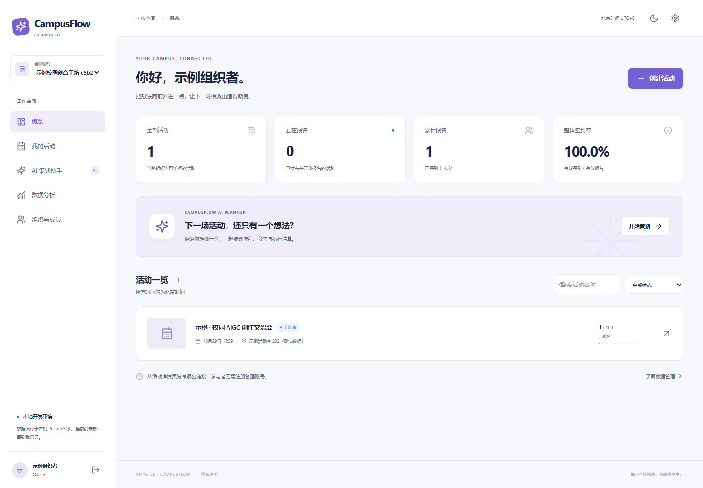

# Amyrtle CampusFlow

让每一场校园活动，都有自己的智能运营团队。

CampusFlow 将活动策划、公开报名、电子凭证、现场签到、统计和复盘连接起来。项目采用 React、TypeScript、Fastify 和 PostgreSQL，面向校园媒体、社团和科创活动组织者。

开源仓库：[Amyrtle/amyrtle-campusflow](https://github.com/Amyrtle/amyrtle-campusflow)，采用 MIT License，可公开浏览和克隆。[GitHub Actions](https://github.com/Amyrtle/amyrtle-campusflow/actions/workflows/ci.yml) 执行检查与测试，线上服务由腾讯云提供。同步方式与访问说明见 [GitHub 交付说明](docs/deployment/github.md)。

## 运行状态

前端与后端已部署至腾讯云体验环境：[打开 CampusFlow 测试站点](https://campusflow-secure-dragon-d6g1dce1lb03f43cf.webapps.tcloudbase.com/)。首次访问会显示腾讯云测试域名提醒，点击“确定访问”后进入。2026-10-28 已验证 HTTP 函数健康、真实共享 PostgreSQL 连接、CORS、正式 CloudBase SDK 密码会话，以及活动、报名、签到、统计、CSV、问卷和模板复盘的 10 阶段线上业务闭环。用户已确认收到真实邮箱验证码并成功登录；后续 OTP 与摄像头修复已发布为 `campusflow-002`（`SUCCESS`）并通过自动化检查。用户已完成 iPhone Safari 核心扫码实测：首次成功、重复扫码仍为 1 / 2，以及识别后、主动停止和后台切换后的预览关闭；云端计数复查一致，专用测试活动已精确清理。拒权、手动替代和硬件指示灯等扩展项未单独真机验证，见 [邮箱与真机验收](docs/testing-email-camera.md)。

最新本地集成检查为 5 个文件、62 项测试通过；10 项本地浏览器测试、7 项真实云数据库验收和 10 阶段真实云业务验收均通过。新增 OTP 用例模拟 SDK、不发送邮件；扫码用例以真实解码器识别合成摄像流，不代替真机摄像头。云端 120 个并发报名请求竞争 100 个名额，最终写入与人数计数均为 100。各层验证时间与限制见 [开发进度](docs/PROGRESS.md) 和 [测试报告](docs/testing.md)。

本地使用磁盘持久化的 PGlite PostgreSQL；本地邮箱密码账号仅用于开发。用户已同意在现有体验环境使用共享 PG 的 HTTPS/RPC 接口；原生 PostgreSQL `DATABASE_URL` 方式继续保留。云端合成账号的密码会话测试与用户确认的邮箱验证码登录分别记录，不混用证据。AI 当前使用明确标识的模板模式。



## 本地启动

需要 Node.js 22.12 或更新版本，推荐 Node.js 24 LTS。

```bash
npm install
npm run dev
```

打开终端显示的地址（默认 http://localhost:5173）。首次使用注册开发账号并创建组织。报名者无需管理账号，可从活动公开链接报名。活动确认发布前不会对外显示。

```bash
npm run lint
npm run typecheck
npm test
npm run build
npx playwright install chromium
npm run test:e2e
```

`npm run format` 用于统一源码格式。测试数据与截图均使用虚构信息，不代表真实运营成果。

构建后可使用 `npm start` 本地启动服务，默认打开 http://127.0.0.1:3001。若复制了 `.env.example`，应将 `APP_ORIGIN` 改为实际访问地址，或用逗号列出你需要的两个本地地址。未设置 `NODE_ENV=production` 的本地启动仍属于开发模式。

本地开发启动会初始化 PGlite 数据结构；也可显式运行 `npm run db:migrate`。共享 PG 的五个版本迁移通过 CloudBase 管理工具执行，生产 API 不自动建表。生产选择 `DATABASE_MODE=cloudbase-http` 与服务端 `CLOUDBASE_DATABASE_API_KEY`，或选择可达的 `DATABASE_URL`，同时配置 `AUTH_MODE=cloudbase`、可信 `APP_ORIGIN` 和持久化 `TICKET_SECRET`。完整变量与操作说明见 [.env.example](.env.example) 和 [部署说明](docs/deployment/README.md)。

## 核心流程

1. 创建组织、邀请成员并分配角色。
2. 输入活动需求生成策划方案；编辑并确认后创建活动草稿。
3. 配置报名时间、容量和字段，检查后发布。
4. 参与者提交报名并保存二维码签到凭证。
5. 授权工作人员扫码或输入签到码；重复扫码不会重复计数。
6. 查看真实报名、签到和反馈数据，导出 CSV，生成可编辑复盘。

AI 模板模式会明确显示标识。缺少地点、嘉宾、预算等信息时保持“待确认”；系统不会将生成内容直接公开发布。

## 工程结构

```text
apps/web/                  React 工作台、公开活动和手机签到页面
services/api/              Fastify API、认证、权限及业务逻辑
packages/shared/           TypeScript 类型与 Zod 数据约束
cloudbase/migrations/      PostgreSQL 表、索引、RLS、业务事务 RPC 与查询目录
cloudbase/deployment/      腾讯云部署配置
tests/integration/         权限、容量和幂等性集成测试
tests/e2e/                 浏览器完整流程测试
tests/cloud/               显式指定环境的真实云数据库验收
docs/                      架构、部署、测试和 TDP 材料
```

具体设计见 [架构说明](docs/architecture/README.md)。CloudBase 官方接入依据见 [参考资料](docs/references.md)。CNB 和 GitHub Actions 默认只执行检查与构建，不自动发布生产环境。

## 数据与安全

报名默认只需要参与者称呼和必要选项。签到二维码不包含个人信息，服务端保存凭证摘要。API 验证组织权限，事务 RPC 对关键业务再次校验；公开接口不提供报名名单。共享 PG 的 RPC 在函数体内拒绝非服务端角色，查询目录仅接受已登记语句的标识与参数。CSV 导出会处理电子表格公式注入风险。

请勿将真实报名数据、`.env`、数据库目录或密钥提交到仓库。安全问题处理方式见 [SECURITY.md](SECURITY.md)，参与开发见 [CONTRIBUTING.md](CONTRIBUTING.md)。

## 许可与作者

MIT License。作者品牌：Amyrtle。

本项目中的高校及组织场景仅作定位和测试用途，不表示获得任何机构授权。TDP 项目材料不代表贡献审核通过或足迹值承诺。
