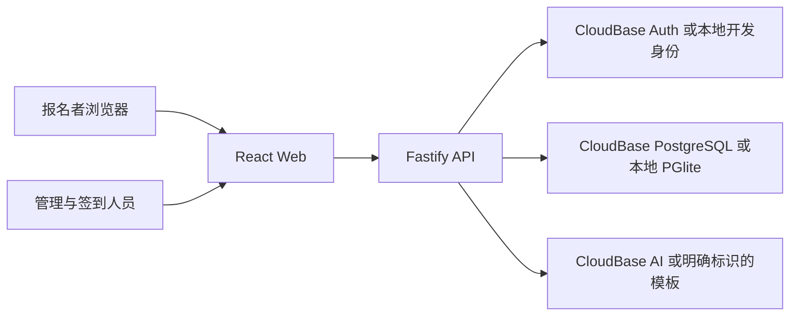
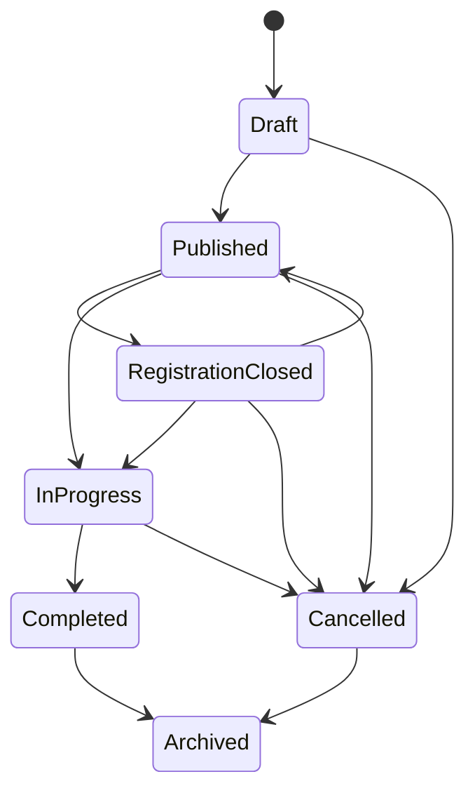

# CampusFlow 架构与业务约束

## 运行边界

浏览器负责展示和表单交互，API 负责身份验证、组织角色、活动状态、容量和签到凭证。数据库保存真实记录；客户端统计来自 API 查询，不另维护一套展示数字。

本地持久化使用 PGlite，即嵌入式 PostgreSQL，提供实际 SQL、约束和事务。生产支持两条路径：使用 `DATABASE_URL` 通过 `pg` 连接可达的 PostgreSQL，或使用 `DATABASE_MODE=cloudbase-http` 连接 CloudBase 共享 PG 的 HTTPS 数据面。用户在 2026-10-26 明确批准后一方式，优先使用现有体验额度。原生 PG 路径继续保留；本地模式不能替代云服务验证。

13 个涉及原子性的业务操作通过 `campusflow_mutate(operation,input)` 执行命名事务；共享模式的单次 RPC 在数据库内完成锁定、校验和写入。本地/原生 PG 也执行相同业务函数，避免维护不同事务语义。普通查询和简单写入通过固定 `campusflow_query(id,params)` 目录；服务端根据已登记语句计算标识，目录不接受 SQL 文本。新增查询需要同步目录和版本迁移。

迁移使用 CloudBase 管理工具，业务运行使用数据库 HTTPS 网关，二者分离。服务器持有 `CLOUDBASE_DATABASE_API_KEY`；浏览器只持有公开配置和用户身份 token。CloudBase RPC 网关不能仅靠 EXECUTE grant 限制调用，因此全部特权函数使用 `SECURITY INVOKER`，并在函数体拒绝 `auth.role() IS DISTINCT FROM 'service_role'`。网关签名身份决定角色，客户端不能自行指定 service_role。

## 组织权限

Owner 管理组织和成员，Admin 管理活动及成员，Staff 仅执行所分配活动的签到与必要运营操作，Viewer 读取授权统计。API 每次检查成员关系及角色，事务 RPC 对关键操作再次检查。服务器角色的数据库访问能力不是自动的租户隔离，固定查询目录也不能代替 API 鉴权。

公开活动页面只公开允许展示的活动字段。报名不要求管理账号；公开报名权限与查看全部报名信息的权限分离。

## 报名和签到

活动报名在数据库事务中锁定或条件更新容量，再插入报名记录。唯一约束防止同一幂等键重复写入。重复请求须返回同一凭证；改变原请求内容的重试被拒绝。凭证不可预测且只持久化安全摘要。

签到必须验证活动、凭证、登录身份和人员权限。唯一约束和事务保证并发重复扫码只生成一次有效签到。摄像头需要 HTTPS 或浏览器允许的本地安全上下文；拒绝权限时提供手动输入。

## 活动状态

合法状态转换只是第一层检查；报名时间窗、剩余容量和用户权限仍由服务端检查。所有业务时间存储为 `timestamptz`，前端统一按 `Asia/Shanghai` 展示。

## AI 数据流

策划按需求理解、策略、宣传、运营和检查五个逻辑步骤组织提示词，输出经过 Zod 校验。模型不可用或未配置时使用明显标识的模板。所有模型请求从服务端发出，模型密钥不会进入浏览器构建。

用户编辑并确认策划后才能创建草稿，发布需要独立操作。复盘仅使用用户有权读取的活动统计与必要反馈；没有反馈或执行记录时明确说明不足。

## 部署与运维

部署以 CloudBase 为目标。前端静态托管；当前 API 优先采用 Node.js HTTP 云函数，CloudRun 容器保留为备选。共享 PG 使用 HTTPS，无需构造 TCP 地址或为此创建 VPC；原生 PG 需要按实例配置网络与 TLS。必须明确配置可信来源、认证环境及服务端密钥。默认 CI 仅检查和构建；真实部署结果见 [进度](../PROGRESS.md) 和 [测试报告](../testing.md)。
